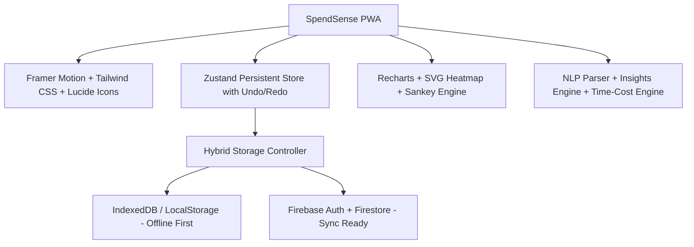

# SpendSense 💸 — Smart Expense Intelligence & Outflow Analytics

SpendSense is a high-velocity, insight-first personal finance tracker engineered to answer three core questions within 3 seconds:
1. **How much am I spending?**
2. **Where does it go?**
3. **What can I do about it right now?**

Built with **React 19, TypeScript, Tailwind CSS, Zustand, Recharts, Framer Motion, and Firebase**, optimized for mobile-first PWA operation with full offline persistence.

---

## 🌟 Hero Features

### 1. "How Much Am I Spending?" Hero Dashboard
- **Giant Count-Up KPI**: Real-time animated number tracking month-to-date expenditure with month-over-month (↑/↓ %) comparison.
- **Daily Safe-To-Spend**: Dynamic algorithm calculating exactly how much you can spend per day for the remaining days of the month without breaking your ceiling.
- **Burn-Rate Velocity Gauge**: Trajectory meter calculating projected month-end spend vs budget.
- **Interactive Visualizations**:
  - Category Donut breakdown with percentage share & slice hover focus.
  - 30-day cumulative spending velocity curve (actual vs. projected).
  - GitHub-style daily calendar heatmap tracking spending intensity and zero-spend days.
- **Time Horizon Switcher**: Weekly, Monthly, and Yearly aggregates.

### 2. Fast Add (< 3 Seconds)
- **Amount-First Numeric Keypad**: Oversized touch-friendly keypad (1–9, ., 0, 00, ⌫) designed for one-handed thumb entry.
- **Smart Predictive Category Chips**: One-tap category selection.
- **Microphone Voice Add**: Integrated Web Speech API button right on the amount screen.

### 3. Natural-Language Multi-Expense Parser
- Type expressions like:
  ```text
  chai 40 and auto 120 yesterday
  swiggy 540 dinner and blinkit 320 groceries
  salary 95000
  ```
- Parses multiple items into separate clean transactions, detects relative dates (`yesterday`, `today`, `tomorrow`), extracts hashtags (`#dinner`), and classifies categories automatically.

### 4. "Time Cost" Lens
- Toggle button in the top navigation instantly translates every expense into **hours and minutes of your life worked** (e.g., `₹1,200` = `2h of work`), based on your hourly earning rate.

### 5. What-If Savings Simulator
- Interactive sliders (Cut Food Delivery by 30%, Cut Shopping by 25%, Cut OTT by 20%).
- Calculates:
  - Monthly Saved (₹)
  - 1-Year Bank Balance Bump (₹)
  - 5-Year Compounding Wealth (at 12% mutual fund growth)
  - Life Work Hours Recovered

### 6. Spending Personality Archetype
- Algorithmic persona generator:
  - **Weekend Warrior**: >45% outflow concentrated on Saturday & Sunday.
  - **Midnight Snacker**: Late-night orders logged past 10 PM.
  - **Subscription Collector**: Connoisseur of streaming & SaaS memberships.
  - **Cafe Hopper**: Artisanal pour-overs and cafe sprint devotee.
  - **Zen Saver**: >40% savings rate accumulator.
  - **Frugal Architect**: Blueprinted, balanced budgetary discipline.

### 7. Money Flow (Sankey) Diagram
- Interactive routing map tracking capital:
  - **Inflows** (TechCorp Salary, Freelance) → **Wallets** (HDFC, UPI, Credit Card, Cash) → **Categories** → **Top Merchants** (Swiggy, Blinkit, Shell, Netflix, Zara).

### 8. Split Bills & IOUs
- Manage shared bills with friends.
- Real-time balance tracker (*"Rahul owes you ₹600 for Toit Brewpub"*).
- One-tap **"Settle Up"** action with confetti celebration.

### 9. Optical Receipt Scanner
- Upload a bill or photo; automated optical neural extraction simulation detects merchant, amount, and date for 1-tap confirmation.

### 10. Spotify-Wrapped Monthly Story Experience
- Swipeable retrospective story cards:
  - Slide 1: Total Outflow & Month-over-Month Discipline
  - Slide 2: The Grand Splurge (Highest transaction)
  - Slide 3: Zero-Spend Masterclass (No-spend days streak)
  - Slide 4: Spending Archetype & Shareable Badge

### 11. Power-User Command Palette (`Cmd+K` / `Ctrl+K`)
- Instant keyboard navigation to all actions, modals, filters, and theme toggles.

---

## 🛠️ Architecture & Tech Stack



- **Frontend**: React 19 + TypeScript (Vite)
- **Styling**: Tailwind CSS v3 with glassmorphic tokens, dark mode default with light toggle, WCAG AA contrast.
- **State**: Zustand with persistence, undo/redo stack, and optimistic updates.
- **Data & Auth**: Firebase v10 with offline persistence cache + seamless local guest demo mode.
- **Testing**: Vitest with unit tests for NLP parsing, Time Cost math, and burn rate projections.
- **PWA**: `vite-plugin-pwa` with service worker caching.

---

## 🚀 Getting Started

### 1. Run Development Server
```bash
npm install
npm run dev
```
Open [http://localhost:5173](http://localhost:5173) in your browser.

### 2. Run Test Suite
```bash
npm test
# Or with vitest run
npx vitest run
```

### 3. Production Build & PWA Generation
```bash
npm run build
```

---

## 🔑 Environment Configuration

Create a `.env` file based on `.env.example`:
```env
VITE_FIREBASE_API_KEY=your_firebase_api_key
VITE_FIREBASE_AUTH_DOMAIN=your-project.firebaseapp.com
VITE_FIREBASE_PROJECT_ID=your-project-id
VITE_FIREBASE_STORAGE_BUCKET=your-project.appspot.com
VITE_FIREBASE_MESSAGING_SENDER_ID=your_messaging_sender_id
VITE_FIREBASE_APP_ID=your_app_id
```
*(SpendSense runs seamlessly in offline local mode without any credentials required).*

---

## 🧪 Testing Verification
- Currency & Indian number formatting tests: **Passed (3/3)**
- Multi-clause NLP parser tests: **Passed (4/4)**
- Safe-to-Spend & burn-rate projections: **Passed (2/2)**
- TypeScript strict compile: **0 errors**
- Production bundle: **Built in 871ms**
